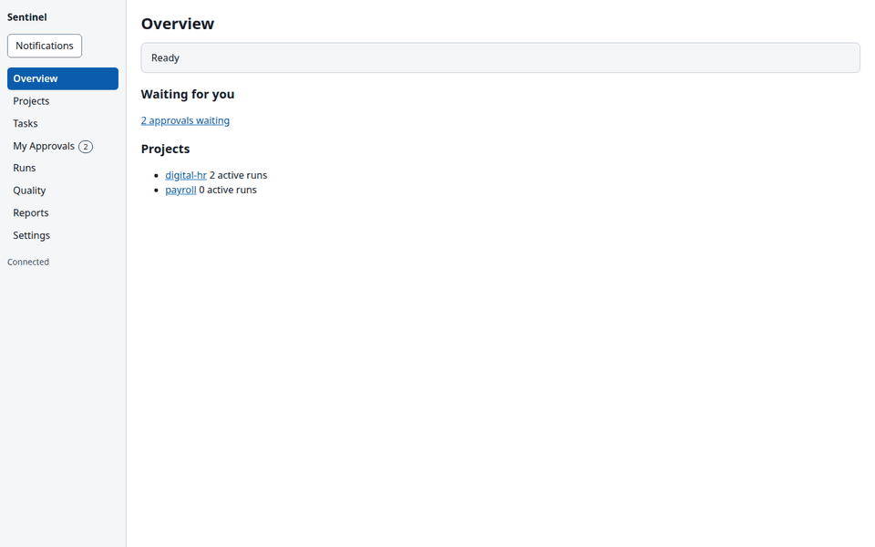
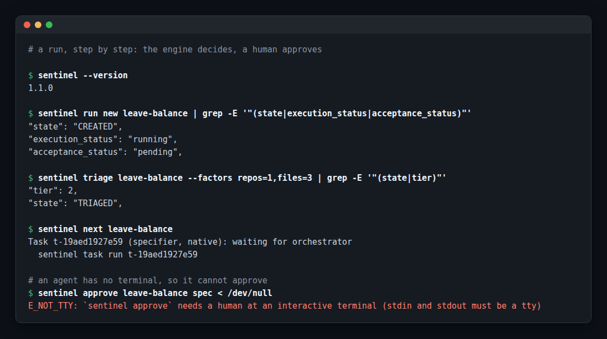
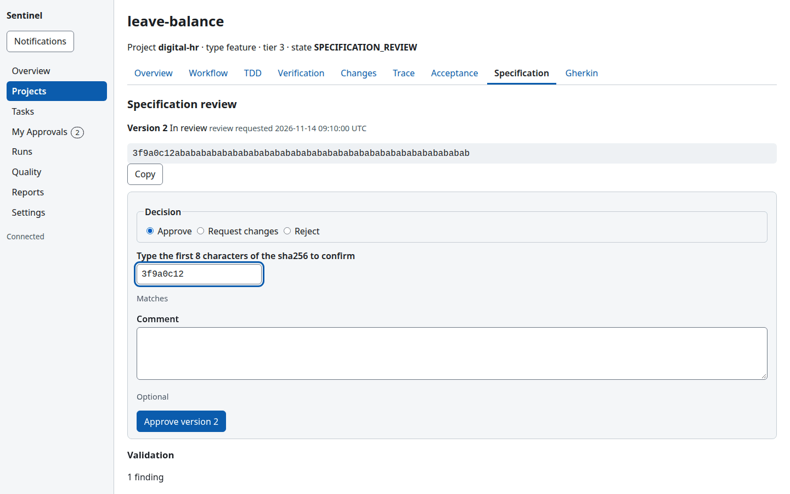
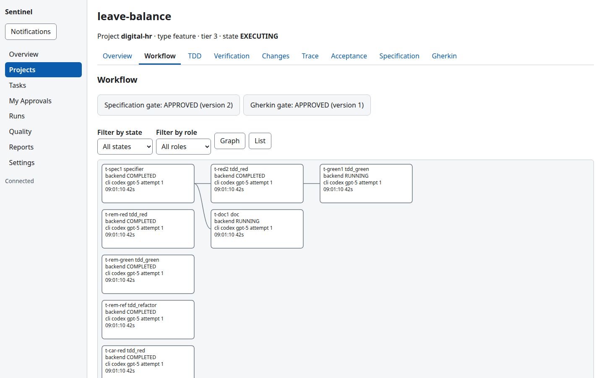

# Sentinel

[](https://pypi.org/project/sentinel-pipeline/) [](https://pypi.org/project/sentinel-pipeline/) [](https://github.com/chhunlyyy/sentinel/blob/main/LICENSE) [](https://github.com/chhunlyyy/sentinel/pkgs/container/sentinel)

Sentinel is a software factory for AI coding agents that you run from your browser.

You write a task. Sentinel's agents size it, write the spec and the test scenarios, build it test first, and the engine checks the result itself. You watch every step on the factory floor and decide at three gates: the spec, the scenarios, and the final result. Every finished change also becomes team knowledge, so the next task starts smarter.

It works with the AI tools you already have: Claude Code, Antigravity, Codex, Gemini CLI, Cursor, or a human. Everything runs on your machine.



*The dashboard with its built-in sample data (two imaginary projects).*

## Start in three minutes

```bash
uv tool install sentinel-pipeline     # the engine, with the dashboard included
sentinel dashboard                    # starts the background service and opens your browser
```

Then, in the browser:

1. **Create a project.** The wizard finds your repositories' stack, test commands and branches, connects your team's shared repo, and suggests which AI model does which job.
2. **Create a task.** Describe a feature or a bug in plain words.
3. **Watch the factory floor.** Each station lights up as its agent works. When a station turns amber, it is waiting for you: review and approve.
4. **Accept the result.** Read the report and the evidence the engine collected, then accept. The changes stay on a branch for your normal pull request.

Close the browser or the terminal at any time: the factory keeps working in the background.

## Two ways to use Sentinel

| | For | Guide |
|---|---|---|
| **The dashboard** | Everyone. Create projects, send tasks, watch the factory, approve and accept, manage knowledge and settings, all in the browser. | [Dashboard user guide](docs/gui-guide.md) |
| **The command line** | Power users, scripts, CI, and running Sentinel from inside your AI tool with `/sentinel`. Every dashboard action has a command. | [Command-line guide](docs/cli-guide.md) |

Both drive the same engine, so you can mix them: create a task in the dashboard and approve it in a terminal, or the other way round.

## How it works: a task through the factory

```
Intake > Triage > Spec > [you approve] > Scenarios > [you approve] > Build (one lane per behavior) > Verify > Report > [you accept] > Knowledge
```

- **Effort scales with the task.** Triage sizes it from seven risk factors. A typo fix is one coder call; a change to who may see salary data gets the full pipeline.
- **Test first, per behavior.** Each behavior gets its own Red, Green and Refactor cycle, with a write scope the agent may not leave.
- **An agent's claim is never evidence.** The engine runs the tests, lint, build and scope checks itself before you see the report.
- **Agents cannot approve.** Approvals need your session and the first 8 characters of the document's hash.
- **The team learns.** Accepted work, and work your team merges without Sentinel, becomes change records and module summaries in the shared repo. Agents read them before they start.

In the terminal the same flow is `sentinel run new`, `sentinel approve` and `sentinel accept`; see the [command-line guide](docs/cli-guide.md) and the [workflow guide](docs/workflow.md). The last command below shows the point of the design: an agent runs without a terminal, so it cannot approve.



## Dashboard

`sentinel dashboard` starts the Sentinel background service on `127.0.0.1` and opens the factory floor. The screens: Factory floor, Overview, Projects (with the Create project wizard), Tasks, My Approvals, Runs, Knowledge, Reports and Settings. Stop the service with `sentinel stop`. The [dashboard user guide](docs/gui-guide.md) walks through them; the [dashboard reference](docs/dashboard.md) covers flags, Docker and security.

The pictures use the dashboard's built-in sample data, not a real project.

| Approve with the hash you typed | The workflow of a run |
|:--|:--|
|  |  |
| **Red, Green and Refactor cycles** | **From requirement to evidence** |
|  |  |
| **Verification the engine ran itself** | **What is waiting for you** |
|  |  |
| **Dark theme** | **Reports** |
|  |  |

Every screen works with the keyboard alone and with the network off. The pictures are made by [`dashboard/scripts/showcase.mjs`](dashboard/scripts/showcase.mjs), see [the dashboard reference](docs/dashboard.md#the-pictures-in-the-readme).


## Install

You need Python 3.10 or newer with [uv](https://docs.astral.sh/uv/) (or pipx), git, and at least one AI coding tool that has a command-line mode (for example Claude Code or Antigravity).

```bash
uv tool install sentinel-pipeline     # or: pipx install sentinel-pipeline
sentinel --version                    # 2.0.0
```

The dashboard is included in the PyPI wheel. A git install (`uv tool install git+https://github.com/chhunlyyy/sentinel`) has the CLI but not the dashboard UI; see the [installation guide](docs/installation.md#the-dashboard-ui).

Want Sentinel inside your AI tool as `/sentinel` too? Add the skills: `npx skills@latest add chhunlyyy/sentinel -a claude-code` (see the [command-line guide](docs/cli-guide.md#skills-for-your-ai-tool)).

Only want to look at the dashboard, without Python? One Docker command serves it for the workspace in the current folder (no AI tool and no secret inside; published on `127.0.0.1` only):

```bash
docker run --rm -it --init -p 127.0.0.1:8765:8765 -v "$PWD":/work -v sentinel-config:/home/sentinel/.config/sentinel ghcr.io/chhunlyyy/sentinel
```

It prints `http://localhost:8765/auth?t=<token>`; open it. See the [dashboard reference](docs/dashboard.md#docker).

Upgrading from 1.x? Read [migrating to 2.0](docs/migration-2.0.md): engine-driven runs need every agent role routed to a command-line AI tool.

## Documentation

- [Dashboard user guide](docs/gui-guide.md)
- [Command-line guide](docs/cli-guide.md)
- [Quickstart](docs/quickstart.md)
- [Installation](docs/installation.md)
- [Workflow, step by step](docs/workflow.md)
- [Knowledge base](docs/knowledge.md)
- [Dashboard reference](docs/dashboard.md)
- [Operations: service, notifications, stats, audit, backup](docs/operations.md)
- [Configuration reference](docs/config.md)
- [Security notes and residual risks](docs/security.md)
- [Migrating from 1.x to 2.0.0](docs/migration-2.0.md)
- [Migrating from 0.1 to 1.1.0](docs/migration-1.1.md)
- [Changelog](CHANGELOG.md)
- [Beta testing guide](docs/beta-testing.md)
- [Pipeline contract](skills/sentinel/pipeline.md)

## Status

Version 2.0.0 (beta). The factory driver, the background service, the factory floor, the project wizard, the settings form and the knowledge base have their own unit, integration, browser and security tests (`python3 tools/release_gate.py` runs them all and checks that every approved acceptance criterion has a passing test). They are new in 2.0.0 and have not yet run with whole teams over weeks of real work. Known limits and residual risks are in [docs/security.md](docs/security.md#residual-risks) and the [changelog](CHANGELOG.md): an agent that runs as your OS user can approve through a pseudo-terminal or the token file, and a provider CLI can run any command during a task. A manual screen-reader pass has not been done. The Codex, Gemini and Cursor adapters have not been tried against the real tools. Read [docs/beta-testing.md](docs/beta-testing.md) before testing. The PyPI distribution is named `sentinel-pipeline` because `sentinel` is taken; the command and the import package are still `sentinel`.

## License

MIT. See [LICENSE](LICENSE).
