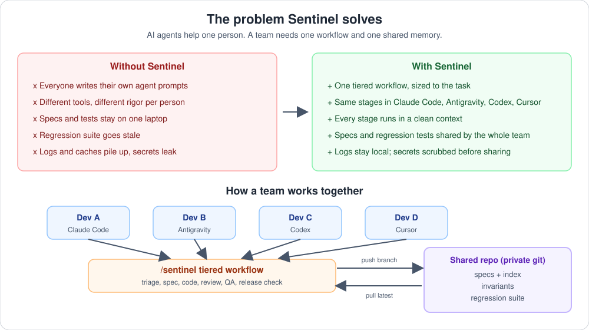
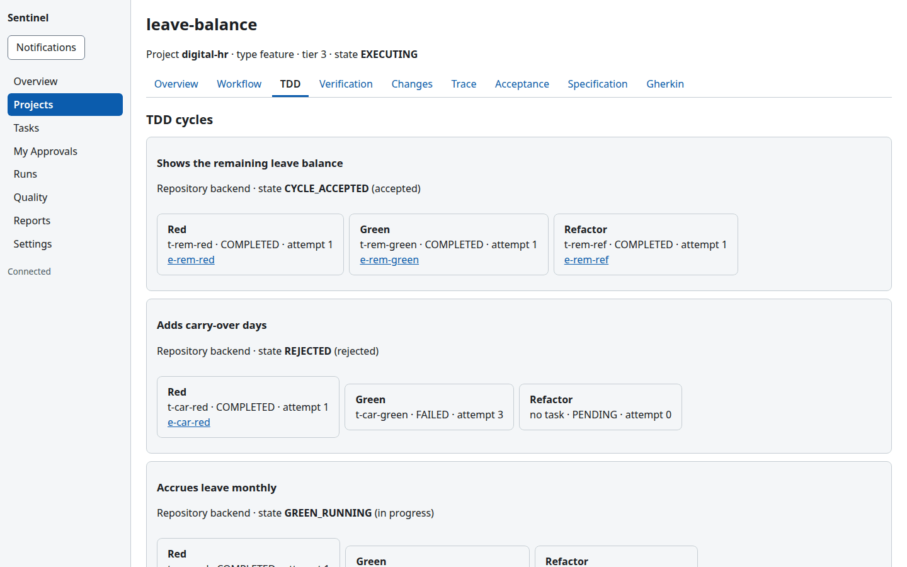
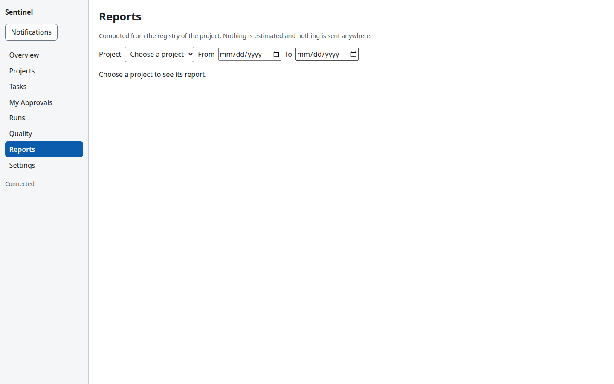
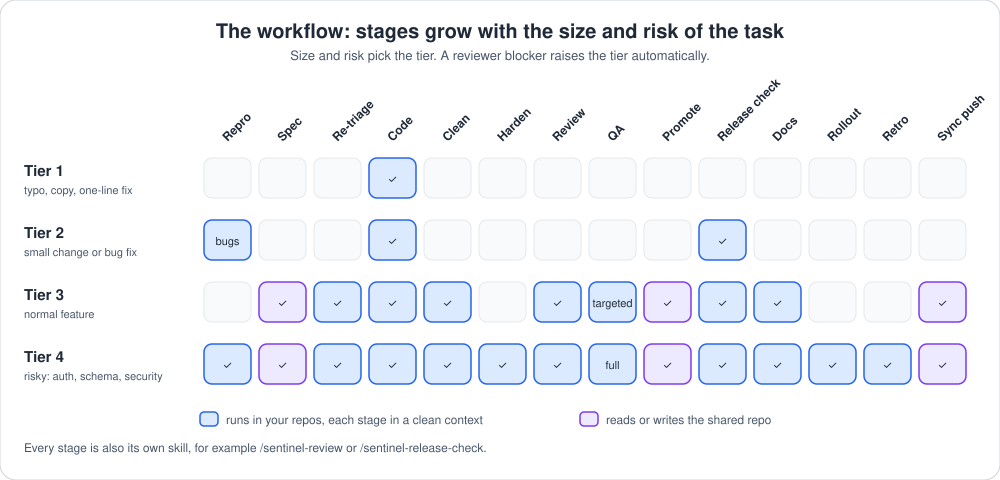

# Sentinel

[](https://pypi.org/project/sentinel-pipeline/) [](https://pypi.org/project/sentinel-pipeline/) [](https://github.com/chhunlyyy/sentinel/blob/main/LICENSE) [](https://github.com/chhunlyyy/sentinel/pkgs/container/sentinel)

Sentinel is a tiered build pipeline for AI coding agents. You describe a feature or a bug. Sentinel decides how much rigor the task needs, then runs only the stages that size of task requires: repro, spec, code, clean, harden, review, QA, regression promotion, release check, docs, rollout notes, and retrospective.

It is provider-neutral. The pipeline is plain files and a small Python CLI. Any agent that can read a prompt and edit files can run a stage: Claude Code, Codex, Gemini CLI, Antigravity, Cursor, or a human.


*The local dashboard, with its built-in sample data (two imaginary projects). It runs on your machine and sends nothing anywhere.*

```bash
uv tool install sentinel-pipeline     # the engine, with the dashboard included
sentinel --version                    # 1.2.1
```

No Python tools? One Docker command serves just the dashboard. See [Install](#install).



## Why

- One run of "implement this properly" usually means five or six hand-written agent prompts, a QA setup, and a lot of logs. Sentinel packages that as config.
- Effort scales with the task. A typo fix is one coder call. A change to authorization rules runs the full pipeline.
- The knowledge a team builds up (specs, project invariants, the regression suite) lives in one shared repo, so it stays current for everyone. Logs and caches stay local and disposable.

## The version 2 flow

Since 1.1.0, `sentinel run new <slug>` creates a **version 2 run**, where you control the requirements and Sentinel controls the process:

```
run new > triage > specification > you approve > Gherkin > you approve > TDD cycles > verify > report > you accept
```

Two human approvals gate everything: the specification, then the Gherkin scenarios (`sentinel review`, `sentinel approve`, in a terminal or in the dashboard). After both, the engine runs one Red, Green and Refactor cycle per behavior with a write scope for every task, verifies the result with its own checks (an agent's claim is never evidence), writes a report, and waits for you to accept it (`sentinel accept`). Any provider CLI can run a task; the engine, not the agent, decides the order, the retries and the result. A version 2 run never pushes to the shared repo by itself. Read the [workflow guide](docs/workflow.md). Runs created with `--legacy`, `--tier` or `--adhoc` use the 0.1 pipeline below, which is unchanged.

The start of a run in a terminal. The output is real, and the last command shows the point of the design: an agent runs without a terminal, so it cannot approve.


## Dashboard

`sentinel dashboard [provider]` starts a local dashboard on 127.0.0.1 and prints a one-time session URL (the optional provider, for example `claude`, is the AI tool that orchestrates runs created in the dashboard). It shows runs, approvals, tasks, the workflow graph, logs, diffs, verification, the trace from requirement to code, notifications and reports, and lets you approve, accept, cancel and create tasks. It works offline and is read only for projects, repos and configuration in 1.1.0. See [the dashboard guide](docs/dashboard.md) and [operations](docs/operations.md) for notifications, stats, audit export and backup.

The pictures use the dashboard's built-in sample data, not a real project.

| Approve with the hash you typed | The workflow of a run |
|:--|:--|
|  |  |
| **Red, Green and Refactor cycles** | **From requirement to evidence** |
|  |  |
| **Verification the engine ran itself** | **What is waiting for you** |
|  |  |
| **Dark theme** | **Reports** |
|  |  |

The same screens are reachable with the keyboard, and the dashboard works with the network off. The pictures are made by [`dashboard/scripts/showcase.mjs`](dashboard/scripts/showcase.mjs), see [the dashboard guide](docs/dashboard.md#the-pictures-in-the-readme).

## How it works (0.1 tiers)



```
Tier 1  Coder
Tier 2  [Repro, bugs only] > Coder > Release check > Metrics > Changelog line
Tier 3  Specifier > Re-triage > Coder > Cleaner > Reviewer > Targeted QA > Regression promotion
        > Release check > Docs and PR draft > Metrics
Tier 4  Specifier > Re-triage > Coder > Cleaner > Hardener > Reviewer > Full QA > Regression promotion
        > Release check > Docs and PR draft > Rollout notes > Retrospective > Metrics
```

The tier depends only on the size and risk of the task (repos touched, files changed, schema change, auth change, security surface). Any single high-risk factor raises the whole run. A reviewer blocker in tier 2 or 3 raises the tier automatically.

For what each step does, who runs it, what it writes and when it stops, read [the workflow guide](docs/workflow.md). The stage-by-stage contract is in [skills/sentinel/pipeline.md](skills/sentinel/pipeline.md).

## Project shapes

`sentinel init` asks for the shape of your project and generates the repo list, agents, and cross-repo steps.

| Shape | Repos | Behavior |
|---|---|---|
| single | one repo, role `app` | no cross-repo steps |
| fullstack | backend and frontend | backend first, one sync checkpoint, then frontend |
| fullstack-mobile | backend, frontend, mobile | backend first, one sync checkpoint, then frontend and mobile in parallel |
| custom | any number of repos and roles | you define the order |

Each repo has its own stack profile (`flutter`, `spring-gradle`, `nextjs`, `node`, `python`, or `generic`), so mixed stacks work.

## Requirements

- Python 3.10 or newer and [uv](https://docs.astral.sh/uv/) (or pipx). `uv` can fetch a suitable Python for you.
- Node (for `npx`), only to install the skills.
- git
- An AI coding tool: Claude Code, Antigravity, Codex, Cursor, OpenCode, Devin, Windsurf, Amp, Pi, or any other tool the [skills installer](https://github.com/vercel-labs/skills) supports.
- `mysql` and `mysqldump`, only if you use the MySQL QA data plugin.

## Install

Two parts, each installed once. The engine is the `sentinel` command; the skills are what your AI tool shows as `/sentinel`. Put the engine on the host: your AI tool runs it there.

```bash
# 1. the engine, with the dashboard included (PyPI distribution "sentinel-pipeline", command "sentinel")
uv tool install sentinel-pipeline

# 2. the skills, for your AI tool (leave -a off to choose from a list)
npx skills@latest add chhunlyyy/sentinel -a claude-code
```

No `uv`? `pipx install sentinel-pipeline` does the same. Check it with `sentinel --version`.

Only want the dashboard, without installing Python tools? One Docker command serves it for the workspace in the current folder (the container holds no AI tool and no secret; it publishes on `127.0.0.1` only):

```bash
docker run --rm -it --init -p 127.0.0.1:8765:8765 -v "$PWD":/work -v sentinel-config:/home/sentinel/.config/sentinel ghcr.io/chhunlyyy/sentinel
```

It prints `http://localhost:8765/auth?t=<token>`; open it. Add `--user $(id -u):$(id -g)` so files it writes in the workspace belong to you (then mount a private config folder you created with `mkdir -m 700 -p`, see the guide). On the host, `sentinel dashboard` picks a free port; `sentinel dashboard --port 8765` fixes it. See the [dashboard guide](docs/dashboard.md#docker).

A git install (`uv tool install git+https://github.com/chhunlyyy/sentinel`) is the developer path: it has the CLI but not the dashboard UI. See the [installation guide](docs/installation.md#the-dashboard-ui) for building it from a checkout.

Agent names for `-a` include `claude-code`, `antigravity-cli`, `codex`, `cursor`, `opencode`, `devin`, `windsurf`, `amp` and `pi`. Skills run with your agent's full permissions, so read what you install; Sentinel's are plain markdown in [skills/](skills/).

The [installation guide](docs/installation.md) covers prerequisites, where each tool's skills end up, verifying the install, rolling it out to a team, upgrading, uninstalling and troubleshooting.

## Use it

Type the command in your tool, or just ask for it in words (tools that do not have slash commands for skills load the skill from its description):

| Command | What it does |
|---|---|
| `/sentinel <task>` | Runs a feature or bug fix through the pipeline at the right tier |
| `/sentinel-setup` | Connects the team's shared repo, picks the project shape, writes the config |
| `/sentinel-resume` | Continues a run that a usage limit or a closed session interrupted |
| `/sentinel-status` | Shows setup health, open runs and cost statistics |
| `/sentinel-sync` | Publishes a finished run's specs and regression tests to the shared repo, after approval |
| `/sentinel-change-map` | Builds the HTML map of everything a run changed |
| `/sentinel-repro` | Writes a failing test or exact steps for a bug, without fixing it |
| `/sentinel-spec` | Turns a request into a spec with Gherkin scenarios and a QA procedure |
| `/sentinel-code` | Implements a change in one repo |
| `/sentinel-clean` | Refactors recent changes for readability |
| `/sentinel-harden` | Runs mutation testing and plugs test gaps |
| `/sentinel-review` | Skeptical read-only review of the current changes |
| `/sentinel-qa` | Runs QA against the running system on throwaway data |
| `/sentinel-promote` | Moves passing QA checks into the shared regression suite |
| `/sentinel-release-check` | Runs the production-readiness gate |
| `/sentinel-docs` | Updates docs and drafts the PR |
| `/sentinel-rollout` | Collects deploy-time changes |
| `/sentinel-retro` | Proposes new project invariants |

You can pick the AI tool and model for each stage (for example the coder on Claude Opus, QA on Claude Sonnet, the hardener on Antigravity with a Gemini model) in `sentinel.config.yaml`; see [routing](docs/config.md#routing-a-model-or-provider-per-stage-optional).

Every stage is also its own skill, so you can run just one without `/sentinel`: for example `/sentinel-review` for a review of your uncommitted changes, or `/sentinel-release-check` before you commit. Each stage skill uses the same instructions as the full pipeline and runs in its own clean context. A standalone run needs a config but no spec, lock or shared repo.

First time in a project, start with `/sentinel-setup` (or run `sentinel init` yourself). It asks for the URL of your team's private shared repo and will not continue without one: that is where your team's rules, specs and regression suite live. Details are in [docs/quickstart.md](docs/quickstart.md).

## Documentation

- [Installation](docs/installation.md)
- [Quickstart](docs/quickstart.md)
- [Workflow, step by step](docs/workflow.md)
- [Dashboard](docs/dashboard.md)
- [Operations: notifications, stats, audit, backup](docs/operations.md)
- [Configuration reference](docs/config.md)
- [Security notes and residual risks](docs/security.md)
- [Migrating from 0.1 to 1.1.0](docs/migration-1.1.md)
- [Changelog](CHANGELOG.md)
- [Beta testing guide](docs/beta-testing.md)
- [Pipeline contract](skills/sentinel/pipeline.md)

## Status

Version 1.2.1 (beta). The version 2 flow, the dashboard, the registry, notifications, analytics, the audit log and backups have a test suite of their own (unit, integration, browser and security tests; `python3 tools/release_gate.py` runs them all and checks that every approved acceptance criterion has a passing test). Known limits and residual risks are stated in [docs/security.md](docs/security.md#residual-risks) and the [changelog](CHANGELOG.md): an agent that runs as your OS user can approve through a pseudo-terminal or the token file, and a provider CLI can run any command during a task. The dashboard cannot create projects or edit configuration yet. The 0.1 stages (specifier, reviewer, hardener, QA, promotion, docs, rollout, retrospective) have run for real on one project only, and the Codex, Gemini and Cursor adapters have not been tried against the real tools. Read [docs/beta-testing.md](docs/beta-testing.md) before testing. The PyPI distribution is named `sentinel-pipeline` because `sentinel` is taken; the command and the import package are still `sentinel`.

## License

MIT. See [LICENSE](LICENSE).
