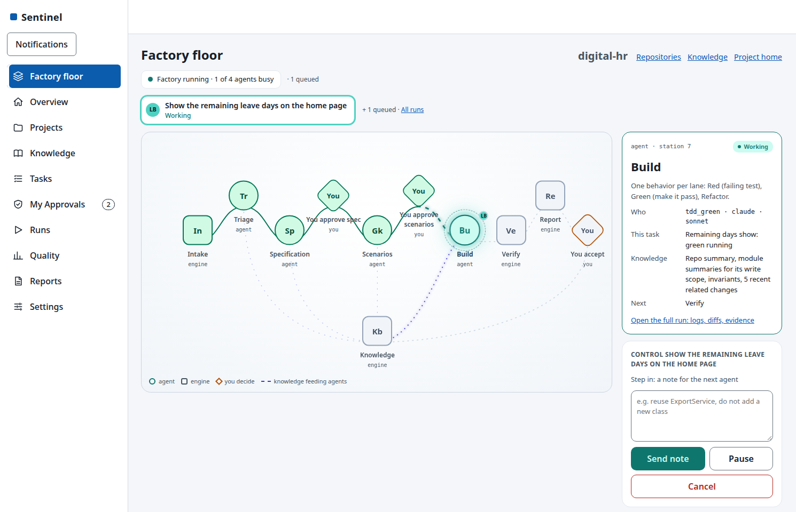
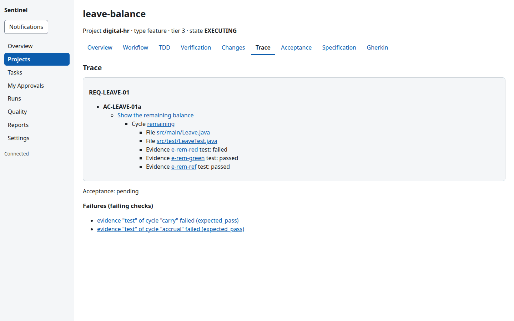
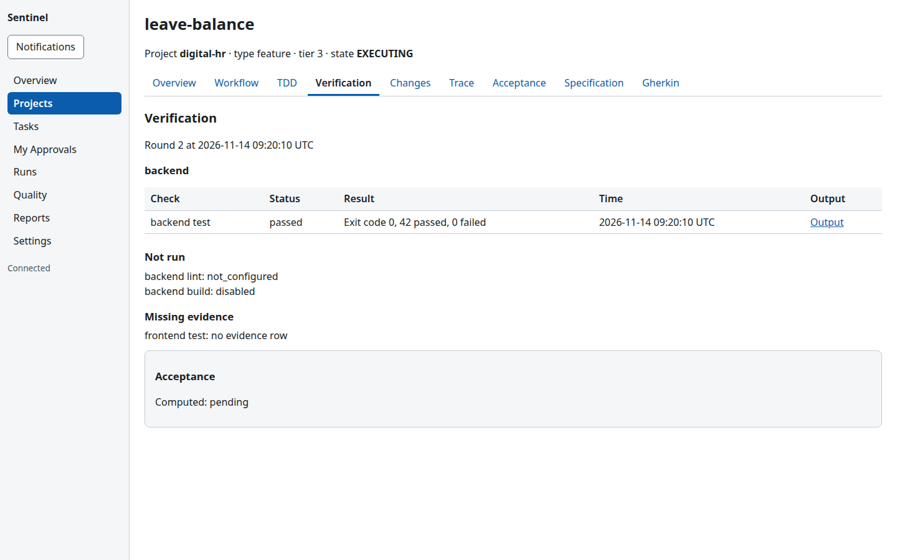
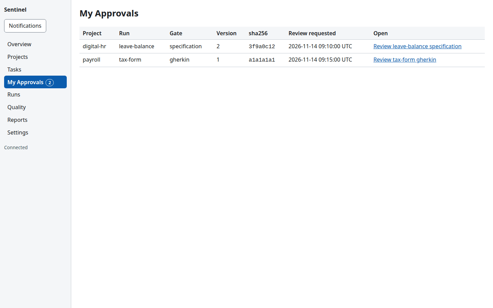
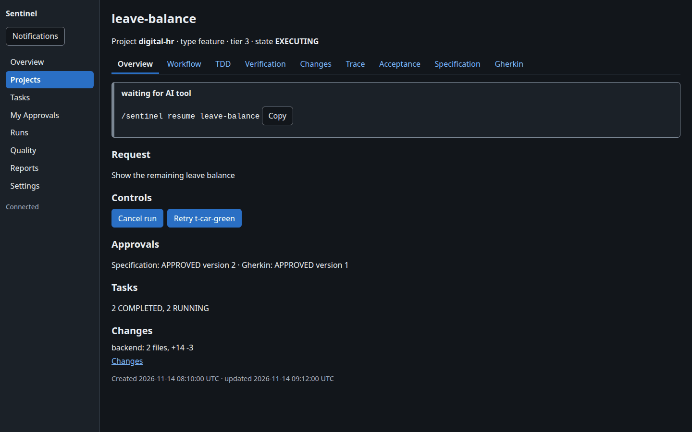

# Sentinel

[](https://pypi.org/project/sentinel-pipeline/) [](https://pypi.org/project/sentinel-pipeline/) [](https://github.com/chhunlyyy/sentinel/blob/main/LICENSE) [](https://github.com/chhunlyyy/sentinel/pkgs/container/sentinel)

**A software factory for AI coding agents, run from your browser.**

You describe a task. Agents write the spec, the test scenarios and the code, test first. The engine checks the result itself. You approve at three gates and watch every step on a live factory floor. Every finished change becomes team knowledge, so the next task starts smarter.

<picture>
  <source media="(prefers-color-scheme: dark)" srcset="https://raw.githubusercontent.com/chhunlyyy/sentinel/main/docs/images/dashboard-factory-floor-dark.png">
  
</picture>

*The factory floor with the dashboard's built-in sample data.*

## Start in three minutes

```bash
uv tool install sentinel-pipeline     # or: pipx install sentinel-pipeline
sentinel dashboard                    # starts the background service and opens your browser
```

1. **Create a project.** The wizard detects your repos' stack, tests and branches, and suggests which AI model does which job.
2. **Create a task.** Describe a feature or a bug in plain words.
3. **Watch the floor.** A station glows while its agent works and turns amber when it waits for you.
4. **Accept the result.** Read the report and the evidence, then accept. The changes stay on a branch for your pull request.

Close the browser at any time: the factory keeps working in the background.

## Why Sentinel

- **Effort scales with the task.** A typo is one coder call. A change to who may see salary data gets the full pipeline.
- **Test first, per behavior.** Each behavior gets its own Red, Green and Refactor lane, inside a write scope the agent may not leave.
- **An agent's claim is never evidence.** The engine runs the tests, lint, build and scope checks itself.
- **Agents cannot approve.** Approvals need your session and the first 8 characters of the document's hash.
- **The team learns.** Accepted work, and work merged without Sentinel, becomes shared knowledge that agents read first.
- **Your tools, your machine.** Claude Code, Antigravity, Codex, Gemini CLI, Cursor, or a human. Everything runs locally.

## How it works

```
Intake > Triage > Spec > [you approve] > Scenarios > [you approve] > Build lanes > Verify > Report > [you accept] > Knowledge
```

Use the [dashboard](docs/gui-guide.md), or the [command line](docs/cli-guide.md) for scripts, CI and `/sentinel` inside your AI tool. Both drive the same engine. In a terminal the flow is `sentinel run new`, `sentinel approve` and `sentinel accept`; an agent has no terminal, so it cannot approve:


## Dashboard

`sentinel dashboard` opens the factory floor on `127.0.0.1`; `sentinel stop` stops the service. Screens: Factory floor, Overview, Projects, Tasks, My Approvals, Runs, Knowledge, Reports and Settings.

<details>
<summary><b>More screenshots</b></summary>


| Approve with the hash you typed | The workflow of a run |
|:--|:--|
|  |  |
| **Red, Green and Refactor cycles** | **From requirement to evidence** |
|  |  |
| **Verification the engine ran itself** | **What is waiting for you** |
|  |  |
| **Dark theme** | **Reports** |
|  |  |


The pictures are made by [`dashboard/scripts/showcase.mjs`](dashboard/scripts/showcase.mjs) from sample data.

</details>

## Install

You need Python 3.10+ with [uv](https://docs.astral.sh/uv/) or pipx, git, and an AI coding tool with a command-line mode.

```bash
uv tool install sentinel-pipeline     # the dashboard is included
sentinel --version                    # 2.1.0
```

A git install has the CLI but not the dashboard UI; see the [installation guide](docs/installation.md#the-dashboard-ui). Add `/sentinel` to your AI tool with `npx skills@latest add chhunlyyy/sentinel -a claude-code`.

Only want to look at the dashboard? One Docker command serves it for the current folder (published on `127.0.0.1` only; open the printed `/auth?t=` link):

```bash
docker run --rm -it --init -p 127.0.0.1:8765:8765 -v "$PWD":/work -v sentinel-config:/home/sentinel/.config/sentinel ghcr.io/chhunlyyy/sentinel
```

Upgrading from 1.x? Read [migrating to 2.0](docs/migration-2.0.md).

## Documentation

- [Dashboard user guide](docs/gui-guide.md) and [command-line guide](docs/cli-guide.md)
- [Quickstart](docs/quickstart.md), [installation](docs/installation.md), [workflow](docs/workflow.md), [knowledge base](docs/knowledge.md)
- [Dashboard reference](docs/dashboard.md), [operations](docs/operations.md), [configuration](docs/config.md), [security](docs/security.md)
- [Migrating from 1.x to 2.0](docs/migration-2.0.md), [migrating to 1.1.0](docs/migration-1.1.md), [changelog](CHANGELOG.md), [beta testing](docs/beta-testing.md), [pipeline contract](skills/sentinel/pipeline.md)

## Status

Version 2.1.0, beta. Every part has unit, integration, browser and security tests, but 2.0 has not yet run with whole teams over weeks of real work. A manual screen-reader pass of the dashboard has not been done; accessibility is covered by automated axe-core checks only. Known limits are in [security](docs/security.md#residual-risks) and the [changelog](CHANGELOG.md). The PyPI name is `sentinel-pipeline` because `sentinel` is taken; the command is still `sentinel`.

MIT licensed. See [LICENSE](LICENSE).
