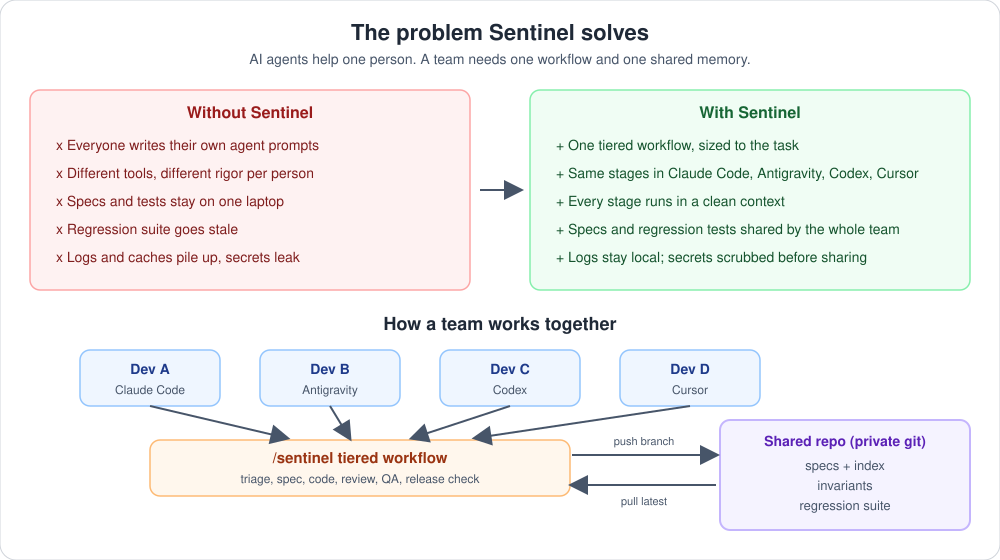
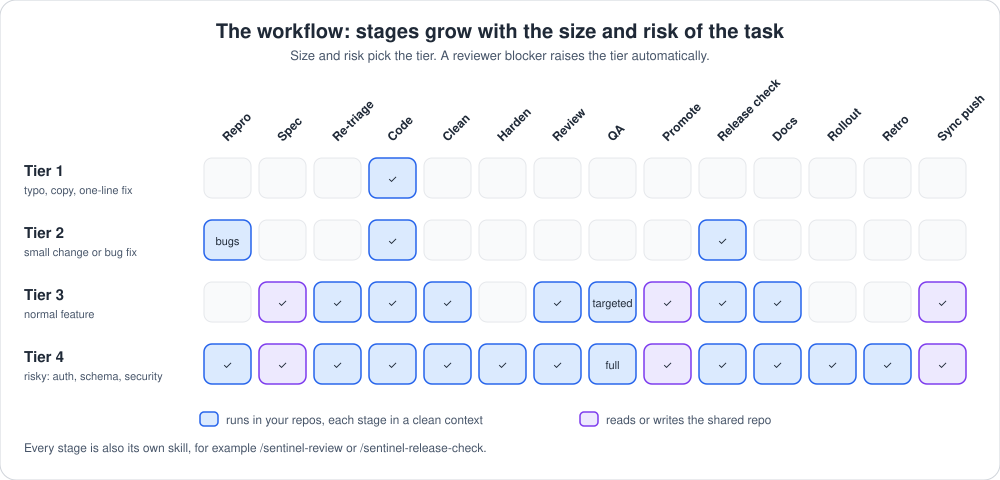

# Sentinel

Sentinel is a tiered build pipeline for AI coding agents. You describe a feature or a bug. Sentinel decides how much rigor the task needs, then runs only the stages that size of task requires: repro, spec, code, clean, harden, review, QA, regression promotion, release check, docs, rollout notes, and retrospective.

It is provider-neutral. The pipeline is plain files and a small Python CLI. Any agent that can read a prompt and edit files can run a stage: Claude Code, Codex, Gemini CLI, Antigravity, Cursor, or a human.



## Why

- One run of "implement this properly" usually means five or six hand-written agent prompts, a QA setup, and a lot of logs. Sentinel packages that as config.
- Effort scales with the task. A typo fix is one coder call. A change to authorization rules runs the full pipeline.
- The knowledge a team builds up (specs, project invariants, the regression suite) lives in one shared repo, so it stays current for everyone. Logs and caches stay local and disposable.

## How it works



```
Tier 1  Coder
Tier 2  [Repro, bugs only] > Coder > Release check > Metrics > Changelog line
Tier 3  Specifier > Re-triage > Coder > Cleaner > Reviewer > Targeted QA > Regression promotion
        > Release check > Docs and PR draft > Metrics
Tier 4  Specifier > Re-triage > Coder > Cleaner > Hardener > Reviewer > Full QA > Regression promotion
        > Release check > Docs and PR draft > Rollout notes > Retrospective > Metrics
```

The tier depends only on the size and risk of the task (repos touched, files changed, schema change, auth change, security surface). Any single high-risk factor raises the whole run. A reviewer blocker in tier 2 or 3 raises the tier automatically.

For what each step does, who runs it, what it writes and when it stops, read [the workflow guide](docs/workflow.md). The stage-by-stage contract is in [skills/sentinel/pipeline.md](skills/sentinel/pipeline.md).

## Project shapes

`sentinel init` asks for the shape of your project and generates the repo list, agents, and cross-repo steps.

| Shape | Repos | Behavior |
|---|---|---|
| single | one repo, role `app` | no cross-repo steps |
| fullstack | backend and frontend | backend first, one sync checkpoint, then frontend |
| fullstack-mobile | backend, frontend, mobile | backend first, one sync checkpoint, then frontend and mobile in parallel |
| custom | any number of repos and roles | you define the order |

Each repo has its own stack profile (`flutter`, `spring-gradle`, `nextjs`, `node`, `python`, or `generic`), so mixed stacks work.

## Requirements

- Python 3.10 or newer and [uv](https://docs.astral.sh/uv/) (or pipx). `uv` can fetch a suitable Python for you.
- Node (for `npx`), only to install the skills.
- git
- An AI coding tool: Claude Code, Antigravity, Codex, Cursor, OpenCode, Devin, Windsurf, Amp, Pi, or any other tool the [skills installer](https://github.com/vercel-labs/skills) supports.
- `mysql` and `mysqldump`, only if you use the MySQL QA data plugin.

## Install

Two parts, each installed once. The engine is the `sentinel` command; the skills are what your AI tool shows as `/sentinel`.

```bash
# 1. the engine
uv tool install git+https://github.com/chhunlyyy/sentinel

# 2. the skills, for your AI tool (leave -a off to choose from a list)
npx skills@latest add chhunlyyy/sentinel -a claude-code
```

Agent names for `-a` include `claude-code`, `antigravity-cli`, `codex`, `cursor`, `opencode`, `devin`, `windsurf`, `amp` and `pi`. Skills run with your agent's full permissions, so read what you install; Sentinel's are plain markdown in [skills/](skills/).

The [installation guide](docs/installation.md) covers prerequisites, where each tool's skills end up, verifying the install, rolling it out to a team, upgrading, uninstalling and troubleshooting.

## Use it

Type the command in your tool, or just ask for it in words (tools that do not have slash commands for skills load the skill from its description):

| Command | What it does |
|---|---|
| `/sentinel <task>` | Runs a feature or bug fix through the pipeline at the right tier |
| `/sentinel-setup` | Connects the team's shared repo, picks the project shape, writes the config |
| `/sentinel-resume` | Continues a run that a usage limit or a closed session interrupted |
| `/sentinel-status` | Shows setup health, open runs and cost statistics |
| `/sentinel-sync` | Publishes a finished run's specs and regression tests to the shared repo, after approval |
| `/sentinel-change-map` | Builds the HTML map of everything a run changed |
| `/sentinel-repro` | Writes a failing test or exact steps for a bug, without fixing it |
| `/sentinel-spec` | Turns a request into a spec with Gherkin scenarios and a QA procedure |
| `/sentinel-code` | Implements a change in one repo |
| `/sentinel-clean` | Refactors recent changes for readability |
| `/sentinel-harden` | Runs mutation testing and plugs test gaps |
| `/sentinel-review` | Skeptical read-only review of the current changes |
| `/sentinel-qa` | Runs QA against the running system on throwaway data |
| `/sentinel-promote` | Moves passing QA checks into the shared regression suite |
| `/sentinel-release-check` | Runs the production-readiness gate |
| `/sentinel-docs` | Updates docs and drafts the PR |
| `/sentinel-rollout` | Collects deploy-time changes |
| `/sentinel-retro` | Proposes new project invariants |

Every stage is also its own skill, so you can run just one without `/sentinel`: for example `/sentinel-review` for a review of your uncommitted changes, or `/sentinel-release-check` before you commit. Each stage skill uses the same instructions as the full pipeline and runs in its own clean context. A standalone run needs a config but no spec, lock or shared repo.

First time in a project, start with `/sentinel-setup` (or run `sentinel init` yourself). It asks for the URL of your team's private shared repo and will not continue without one: that is where your team's rules, specs and regression suite live. Details are in [docs/quickstart.md](docs/quickstart.md).

## Documentation

- [Installation](docs/installation.md)
- [Quickstart](docs/quickstart.md)
- [Workflow, step by step](docs/workflow.md)
- [Configuration reference](docs/config.md)
- [Security notes](docs/security.md)
- [Beta testing guide](docs/beta-testing.md)
- [Pipeline contract](skills/sentinel/pipeline.md)

## Status

Internal beta, version 0.1.0b3. It has run end to end on one project (Tier 2 bug fix on a Spring Boot and Next.js workspace) and passes its own self-test (`sentinel selftest`, dozens of checks on a throwaway workspace). The specifier, reviewer, hardener, QA, promotion, docs, rollout and retrospective stages have not run for real yet, and the Codex, Gemini and Cursor adapters have not been tried against the real tools. Read [docs/beta-testing.md](docs/beta-testing.md) before testing. The name "Sentinel" has not been checked for availability on package registries.

## License

MIT. See [LICENSE](LICENSE).
