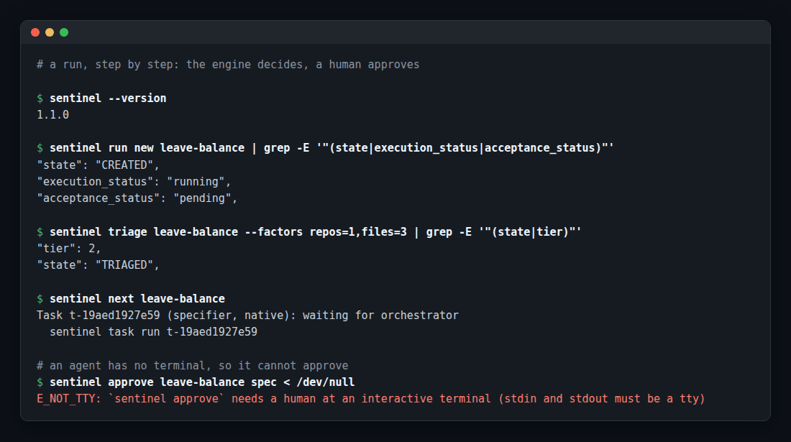

# Command-line guide

Everything the dashboard does has a command. Use the command line for scripts and CI, for working in a terminal, or to run Sentinel from inside your AI tool with `/sentinel`. For the browser, see the [dashboard user guide](gui-guide.md).

## Set up a workspace

```bash
cd my-workspace
sentinel init          # asks for the shared repo URL, the project shape and each repo's stack; writes sentinel.config.yaml
sentinel doctor        # checks the config, the tools it needs and that the shared repo is cloned
```

`sentinel init` asks for the shape of your project and generates the repo list, agents and cross-repo steps:

| Shape | Repos | Behavior |
|---|---|---|
| single | one repo, role `app` | no cross-repo steps |
| fullstack | backend and frontend | backend first, one sync checkpoint, then frontend |
| fullstack-mobile | backend, frontend, mobile | backend first, one sync checkpoint, then frontend and mobile in parallel |
| custom | any number of repos and roles | you define the order |

Each repo has its own stack profile (`flutter`, `spring-gradle`, `nextjs`, `node`, `python`, or `generic`), so mixed stacks work. All settings are in the [configuration reference](config.md).

## Run a task

A version 2 run goes through the same stations as on the factory floor:

```
run new > triage > specification > you approve > Gherkin > you approve > TDD cycles > verify > report > you accept
```

Let the engine drive it (the factory starts every agent itself):

```bash
sentinel run new leave-export --type feature --driver engine --request "HR exports leave balances as CSV, HR only"
```

Or drive it yourself, or with your AI tool's `/sentinel` skill (the default `--driver cli`):

```bash
sentinel run new leave-export --type feature
sentinel next leave-export          # what to do now; your AI tool follows this in a loop
```

Your decisions work the same either way:

```bash
sentinel review leave-export spec      # read the specification
sentinel approve leave-export spec     # type the hash prefix to approve
sentinel review leave-export gherkin
sentinel approve leave-export gherkin
sentinel report leave-export           # after the engine verified the build
sentinel accept leave-export
```

`approve` and `accept` need an interactive terminal and the typed hash prefix, so an agent cannot run them. A version 2 run never pushes to the shared repo by itself; `sentinel sync push leave-export` publishes specs and regression tests after your approval. The [workflow guide](workflow.md) explains every step.

The start of a run in a terminal. The last command shows the point of the design: an agent runs without a terminal, so it cannot approve.



### Control a running task

```bash
sentinel pause leave-export                                 # start nothing new; running work finishes
sentinel unpause leave-export
sentinel note leave-export "reuse ExportService, do not add a new class"   # read once by the next agent
sentinel resolve leave-export --refresh-config -m "routing fixed"          # pick up a changed config
```

## The background service

```bash
sentinel service start        # start the factory in the background
sentinel service status       # running or not, port, uptime, log file
sentinel service stop         # or: sentinel stop
sentinel service pause -m "deploy window"   # whole factory: nothing new starts in any project; running work finishes
sentinel service resume       # runs you paused one by one stay paused
sentinel service autostart on # start at login (Linux, systemd user unit)
sentinel dashboard            # start the service if needed and open the browser
sentinel dashboard --foreground   # the old way: the server lives in this terminal
```

See [operations](operations.md) for logs, notifications, stats, the audit log and backups.

## Knowledge base

```bash
sentinel kb status                    # cursors, record counts, background jobs
sentinel kb ingest                    # record new merges on the tracked branches
sentinel kb backfill --since 2026-08-01   # older history; prints an estimate and asks first
sentinel kb snapshot                  # refresh repository and module summaries
```

The CI template for capturing work done outside Sentinel is `sentinel/templates/ci/knowledge-ingest.yml`. See the [knowledge base guide](knowledge.md).

## Skills for your AI tool

Install the skills once so your AI tool knows `/sentinel`:

```bash
npx skills@latest add chhunlyyy/sentinel -a claude-code
```

Agent names for `-a` include `claude-code`, `antigravity-cli`, `codex`, `cursor`, `opencode`, `devin`, `windsurf`, `amp` and `pi`. Skills run with your agent's full permissions, so read what you install; Sentinel's are plain markdown in [skills/](../skills/).

Type the command in your tool, or just ask for it in words:

| Command | What it does |
|---|---|
| `/sentinel <task>` | Runs a feature or bug fix through the pipeline at the right tier |
| `/sentinel-setup` | Connects the team's shared repo, picks the project shape, writes the config |
| `/sentinel-resume` | Continues a run that a usage limit or a closed session interrupted |
| `/sentinel-status` | Shows setup health, open runs and cost statistics |
| `/sentinel-sync` | Publishes a finished run's specs and regression tests to the shared repo, after approval |
| `/sentinel-change-map` | Builds the HTML map of everything a run changed |
| `/sentinel-repro` | Writes a failing test or exact steps for a bug, without fixing it |
| `/sentinel-spec` | Turns a request into a spec with Gherkin scenarios and a QA procedure |
| `/sentinel-code` | Implements a change in one repo |
| `/sentinel-clean` | Refactors recent changes for readability |
| `/sentinel-harden` | Runs mutation testing and plugs test gaps |
| `/sentinel-review` | Skeptical read-only review of the current changes |
| `/sentinel-qa` | Runs QA against the running system on throwaway data |
| `/sentinel-promote` | Moves passing QA checks into the shared regression suite |
| `/sentinel-release-check` | Runs the production-readiness gate |
| `/sentinel-docs` | Updates docs and drafts the PR |
| `/sentinel-rollout` | Collects deploy-time changes |
| `/sentinel-retro` | Proposes new project invariants |

Every stage is also its own skill, so you can run just one: for example `/sentinel-review` for a review of your uncommitted changes, or `/sentinel-release-check` before you commit. A standalone stage needs a config but no spec, lock or shared repo.

You can pick the AI tool and model for each role in `sentinel.config.yaml`; see [routing](config.md#routing-a-model-or-provider-per-stage-optional).

## The 0.1 tier pipeline

Runs created with `--legacy`, `--tier` or `--adhoc` use the original tiered pipeline, unchanged:

```
Tier 1  Coder
Tier 2  [Repro, bugs only] > Coder > Release check > Metrics > Changelog line
Tier 3  Specifier > Re-triage > Coder > Cleaner > Reviewer > Targeted QA > Regression promotion
        > Release check > Docs and PR draft > Metrics
Tier 4  Specifier > Re-triage > Coder > Cleaner > Hardener > Reviewer > Full QA > Regression promotion
        > Release check > Docs and PR draft > Rollout notes > Retrospective > Metrics
```

The tier depends only on the size and risk of the task (repos touched, files changed, schema change, auth change, security surface). Any single high-risk factor raises the whole run. The stage-by-stage contract is in [skills/sentinel/pipeline.md](../skills/sentinel/pipeline.md).

## All commands

`sentinel --help` lists every command, and `sentinel <command> --help` explains one.
